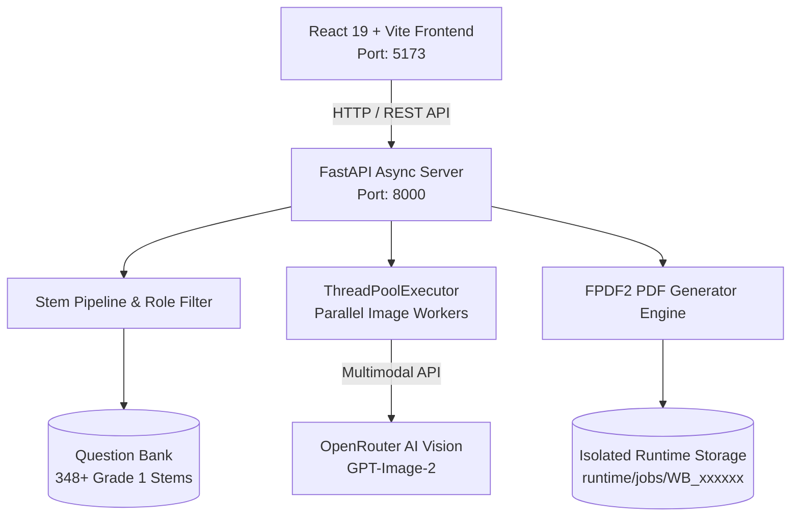

# 📚 MyInteliBooks — AI Personalized Multi-Grade Math Workbook Generator

[](https://python.org)
[](https://fastapi.tiangolo.com)
[](https://react.dev)
[](https://vitejs.dev)
[](https://py-pdf.github.io/fpdf2/)
[](https://openrouter.ai)
[](https://docs.pytest.org)

**MyInteliBooks** is an enterprise-grade educational publishing platform and AI workbook generator that transforms standard elementary mathematics curricula into fully personalized, beautifully illustrated practice workbooks.

Every workbook is customized around the child: word problems incorporate the child's name, family members (parents, siblings, grandparents, aunt/uncle), and favorite foods and hobbies. High-fidelity educational illustrations are generated using multimodal generative vision models (`openai/gpt-image-2` via OpenRouter), incorporating the child's and family's reference photos directly into the scenes without awkward face-swapping artifacts.

---

## 🌟 Key Features

### 1. 🎯 1-Call Multimodal AI Scene Generation
* Reference photos of the child and family members are fed directly into the visual generative model alongside detailed prompt instructions and curriculum parameters.
* Characters in the illustrations consistently reflect the child's age, hairstyle, facial features, and ethnicity in cohesive, soft-card educational styles.
* Eliminates multi-step post-processing or robotic compositing.

### 2. 🔢 Exact Mathematical Object Count Engine
* Solves the common generative AI counting inaccuracy through our **Object Count & Visual Group Specification Engine** (`build_count_specification()`).
* Parses mathematical metadata (`visual_groups`, group quantities, `crossed_count`, `circled_count`, arithmetic formulas) and injects strict mathematical constraints at top priority.
* Prevents hallucinated or stray background objects from corrupting math counting exercises.

### 3. ⚡ High-Speed Concurrency (75% Faster Turnaround)
* Employs `concurrent.futures.ThreadPoolExecutor` to generate question scenes simultaneously in parallel.
* Generates the personalized front cover concurrently in a background thread alongside question illustrations.
* Generates a complete 4-to-6 question personalized landscape PDF in **under 60 seconds** (down from 4.5+ minutes).

### 4. 📐 Scalable Multi-Grade Architecture
* Clean configuration-driven curriculum registry (`config/grades.json`, `config/topics.json`).
* **Grade 1** is fully populated with **348+ verified question stems** spanning 10 core topics.
* Architectural scaffolding ready for Kindergarten (`KG`, `PG`, `Nursery`, `Prep`) and `Grade 2` through `Grade 10`.
* **Strict Non-Fallback Policy**: Explicit error handling ensures unavailable grades never silently downgrade or scramble curriculum content.

### 5. 👨‍👩‍👧‍👦 Dynamic Family & Role-Based Filtering
* Automatically detects uploaded family members (Child, Mum, Dad, Grandma, Grandad, Sibling, Aunt, Uncle).
* Smart role-filtering selects only math stems matching the available family members, adjusting grammatical pronouns and relations dynamically.

### 6. 📄 Print-Ready Landscape PDF Publishing
* Compiles high-resolution A4 landscape workbooks with:
  * Personalized illustrated front cover with topic pills and student badges.
  * Custom soft-card framed math illustration scenes.
  * Easy-to-read typography using Google Fonts (**Baloo 2** & **Quicksand**).
  * Color-coordinated design accents reflecting the child's favorite color.
  * Large-font word problem stems, multiple-choice option pills, working workspace, and celebratory achievement badges.

---

## 🏗️ Architecture & Technology Stack



| Layer | Technologies | Description |
| :--- | :--- | :--- |
| **Frontend** | React 19, Vite 6, Vanilla CSS | Reactive wizard interface with photo upload, live validation, and real-time generation progress. |
| **Backend API** | FastAPI, Uvicorn, Pydantic | Asynchronous REST service handling validation, job orchestration, and PDF downloads. |
| **Curriculum Engine** | Python 3.10+, JSON Metadata | Topic balancing, counting ceiling validation, and role-based stem substitution. |
| **AI Vision Engine** | OpenRouter (`openai/gpt-image-2`) | Multimodal character identity preservation and exact visual group layout. |
| **PDF Compiler** | FPDF2, Pillow | Vector landscape page layout, custom font embedding, and image rendering. |
| **Legacy UI** | Streamlit | Lightweight fallback interface for quick administrative testing. |

---

## 📁 Repository Structure

```text
myintelibooks/
├── 🔑 .env.example                         # Environment variables template
├── 📋 requirements.txt                     # Python backend dependencies
├── 🚀 run.py                               # Unified multi-service launcher
├── 📖 README.md                            # Comprehensive project documentation
├── ⚙️ .gitignore                           # Git ignore rules for Python, Node, & artifacts
│
├── 📁 app/                                 # Core Python Engine
│   ├── 🌐 api_server.py                    # FastAPI application & REST endpoints
│   ├── 🚀 newapp.py                        # Legacy Streamlit application
│   ├── ⚙️ grade_config.py                  # Grade registry, paths & runtime job manager
│   ├── 🧠 stem_pipeline.py                 # Stem selection, role filtering & MCQ generation
│   ├── 🎨 image_generator.py               # Multimodal prompt engine & parallel image client
│   ├── 🖼️ front_cover_generator.py         # Front cover AI illustration engine
│   ├── 📄 pdf_generator.py                 # Multi-page landscape PDF compiler (FPDF2)
│   ├── 🛠️ utils.py                         # Text normalization, grammar & file utilities
│   └── 📄 __init__.py
│
├── 📁 frontend/                            # Modern React 19 Frontend
│   ├── 📄 package.json                     # Frontend dependencies & scripts
│   ├── 📄 vite.config.js                   # Vite bundler & reverse proxy configuration
│   ├── 📄 index.html                       # HTML5 template
│   └── 📁 src/
│       ├── 📄 App.jsx                      # Main application component & form state
│       ├── 📄 main.jsx                     # React DOM entry point
│       ├── 🎨 index.css                    # Design system, variables & animations
│       └── 📁 components/                  # UI components (PhotoUpload, StepCards, etc.)
│
├── 📁 config/                              # System Configuration & Registries
│   ├── ⚙️ grades.json                      # Supported grades and enablement flags
│   ├── 📚 topics.json                      # Topic definitions & taxonomy
│   ├── 🤖 models.json                      # AI model configurations and limits
│   └── 🛠️ app_config.json                  # Job ID generation & app runtime settings
│
├── 📁 grades/                              # Curriculum Content by Grade Level
│   ├── 📁 Grade_1/                         # Production Grade 1 Content
│   │   ├── ⚙️ config.json                  # Grade manifest, topic mapping & features
│   │   ├── 📁 questions/
│   │   │   ├── 📁 primary/                 # 10 core topic folders (Addition, Money, etc.)
│   │   │   └── 📁 fallback/                # Classic fallback stem banks
│   │   ├── 📁 prompts/
│   │   │   ├── question_image.md           # Master prompt template for question scenes
│   │   │   └── front_page.md               # Master prompt template for front covers
│   │   └── 📁 assets/reference/            # Visual cluster & style references
│   │
│   └── 📁 KG/, PG/, Nursery/, Grade_2/ ..  # Architectural placeholders for future grades
│
├── 📁 shared/                              # Shared Static Assets
│   ├── 📁 fonts/                           # Baloo 2 & Quicksand TTF fonts
│   ├── 📁 icons/                           # Visual badges & math icons
│   ├── 📁 prompts/                         # Global fallback prompt templates
│   └── 📁 assets/                          # Common branding assets
│
├── 📁 runtime/                             # Isolated Execution Storage
│   └── 📁 jobs/
│       ├── .gitkeep                        # Git placeholder
│       └── 📁 WB_xxxxxx/                   # Isolated per-job workspace
│           ├── metadata.json               # Job state, child details & file paths
│           ├── 📁 uploads/                 # Uploaded family reference photos
│           ├── 📁 generated_images/        # Question illustration PNGs
│           ├── 📁 front_cover/             # Front cover illustration PNG
│           └── 📁 generated_pdfs/          # Compiled landscape workbook PDF
│
└── 📁 tests/                               # Automated Test Suite (Pytest)
    ├── 📄 test_grade_config.py             # Config resolution, path lookup & strict errors
    ├── 📄 test_grade1_workflow.py          # Stems pipeline, MCQ, prompts & PDF tests
    └── 📄 __init__.py
```

---

## ⚡ Quick Start Guide

### 1. Prerequisites
* **Python**: 3.10, 3.11, or 3.12 installed
* **Node.js**: 18.0 or higher (`npm` included)
* **OpenRouter Account**: Valid API key with access to visual models ([openrouter.ai](https://openrouter.ai))

### 2. Clone the Repository
```bash
git clone https://github.com/mhamdanhontor/myintelibooks.git
cd myintelibooks
```

### 3. Configure Environment Variables
Copy `.env.example` to `.env`:
```bash
cp .env.example .env
```
Open `.env` and set your OpenRouter API key:
```env
OPENROUTER_API_KEY=sk-or-v1-xxxxxxxxxxxxxxxxxxxxxxxxxxxxxxxx
```

### 4. Install Dependencies

#### Backend:
```bash
pip install -r requirements.txt
```

#### Frontend:
```bash
cd frontend
npm install
cd ..
```

---

## 🚀 Running the Application

The unified runner script `run.py` handles starting the backend and frontend automatically.

### Mode 1: Full Development (FastAPI + React with Hot Reload) — **Recommended**
```bash
python run.py
```
* **React Web App**: [http://localhost:5173](http://localhost:5173)
* **FastAPI Backend & Swagger Docs**: [http://127.0.0.1:8000/docs](http://127.0.0.1:8000/docs)
* Automatically checks dependencies, launches both services, and opens your default browser.

### Mode 2: Single-Server Production Mode
Runs FastAPI serving the pre-built React application directly from a single port:
```bash
python run.py --mode prod
```
* Access at: [http://127.0.0.1:8000](http://127.0.0.1:8000)

### Mode 3: Backend API Only
```bash
python run.py --mode backend
```

### Mode 4: Legacy Streamlit UI
```bash
python run.py --mode streamlit
# Or directly:
streamlit run app/newapp.py
```

---

## 📚 Curriculum & Mathematics Topics

Grade 1 includes **348+ individual question stems** organized across 10 curriculum topics:

| Topic Code | Topic Name | Questions | Mathematical Competencies |
| :--- | :--- | :---: | :--- |
| `addition` | Addition | 40+ | Combining groups, counting on, word problems within 10 & 20. |
| `subtraction` | Subtraction | 40+ | Take-away, crossing out objects, comparing quantities. |
| `money` | Money | 30+ | Coin recognition, calculating change, price additions. |
| `time` | Time | 30+ | O'clock, half-past, daily schedules, duration. |
| `fractions` | Fractions | 25+ | Halves and quarters of shapes and object sets. |
| `geometry` | Geometry | 35+ | 2D/3D shapes, sides, vertices, visual patterns. |
| `measurement` | Measurement | 30+ | Comparing length, height, weight, and volume. |
| `number_place_value` | Number & Place Value | 40+ | Counting forwards/backwards, ten-frames, numerals to words. |
| `multiplication` | Early Multiplication | 25+ | Repeated addition, equal groups, arrays. |
| `division` | Early Division | 20+ | Sharing equally into groups, grouping objects. |

### Question Stem Schema
Each question stem is maintained in an isolated directory with 3 files:
1. `stem.txt`: The parametrized question text with tokens (e.g., `"{student_name} baked {count_1} {fav_food}s..."`).
2. `meta.json`: Mathematical truth definitions:
   ```json
   {
     "answer": 7,
     "formula": "4 + 3 = 7",
     "counting_ability": 10,
     "visual_groups": [
       {"label": "chocolate chip cookies", "count": 4, "role": "student"},
       {"label": "sugar cookies", "count": 3, "role": "mum"}
     ],
     "options": [7, 5, 8, 6],
     "required_roles": ["student", "mum"]
   }
   ```
3. `variants.json`: Alternative phrasings and narrative variations.

---

## 🔌 REST API Endpoints

| Method | Endpoint | Description |
| :--- | :--- | :--- |
| `GET` | `/api/grades` | List all registered grades and their enablement status. |
| `GET` | `/api/topics?grade_id=Grade_1` | Retrieve topics available for the chosen grade. |
| `GET` | `/api/stems/count` | Query stem counts matching selected filters and roles. |
| `POST` | `/api/generate-workbook` | Submit workbook generation request (multipart form with photos). |
| `GET` | `/api/jobs/{job_id}/status` | Poll real-time generation progress, current step, and logs. |
| `GET` | `/api/jobs/{job_id}/pdf` | Stream or download the generated PDF workbook. |

---

## 🧪 Automated Testing

The project includes automated test coverage validating curriculum integrity, stem schemas, prompt templates, config resolution, and PDF generation:

```bash
# Run the complete test suite
pytest -v
```

All 43 tests verify:
- ✅ Grade registry integrity and strict non-fallback validation.
- ✅ Dynamic token substitution (`{student_name}`, `{fav_food}`, `{mum_name}`, etc.).
- ✅ MCQ generation and correct answer placement.
- ✅ Mathematical object count extraction across all stems.
- ✅ Runtime directory structure and job metadata isolation.
- ✅ End-to-end PDF generation workflow with FPDF2.

---

## 🛡️ License & Contributing

* **Author**: MUHAMMAD HAMDAN ([@mhamdanhontor](https://github.com/mhamdanhontor))
* **Repository**: [https://github.com/mhamdanhontor/myintelibooks.git](https://github.com/mhamdanhontor/myintelibooks.git)
* **License**: Private / Proprietary Educational Software
